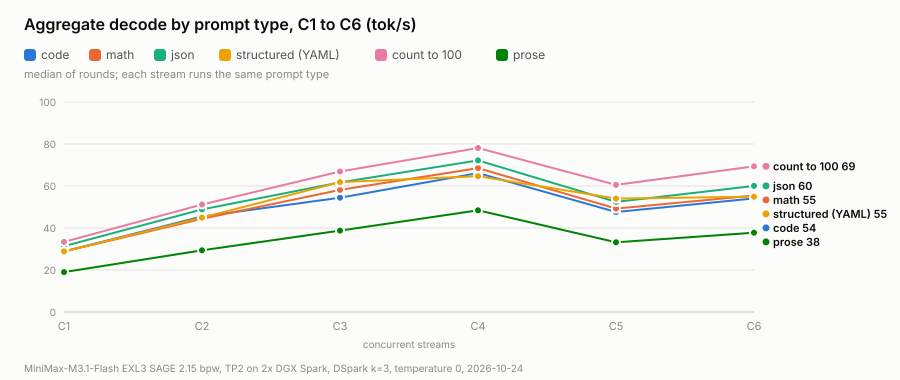
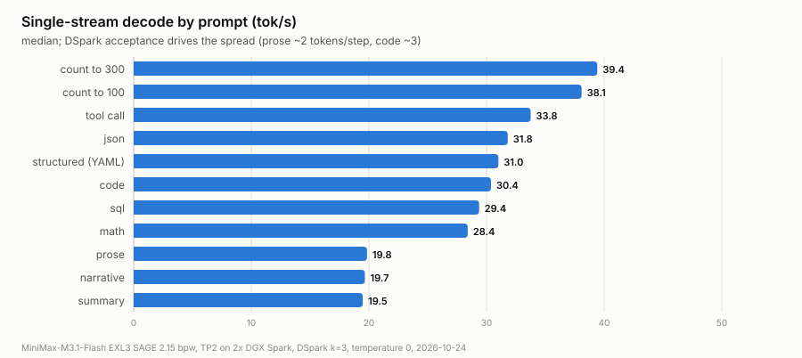
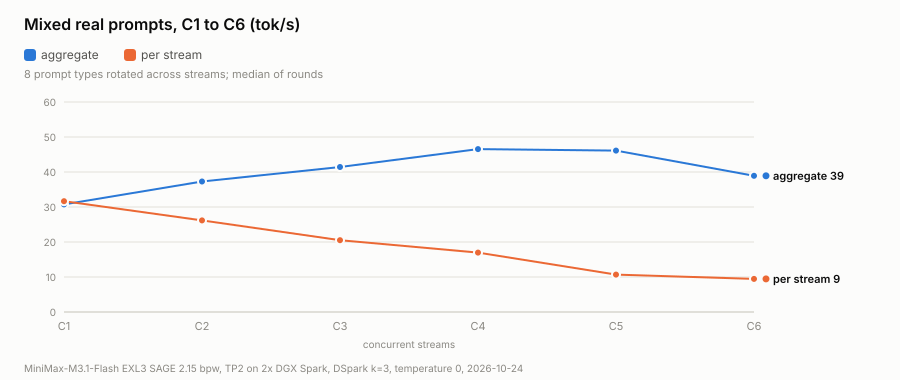
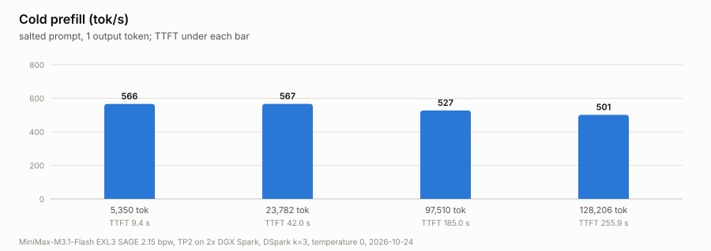

# MiniMax-M3.1-Flash EXL3 (SAGE 2.15 bpw) on two DGX Sparks: TP2, 300K context

> **Special credit: [vcruz305](https://github.com/vcruz305).** The pack, the serving image and both runtime forks are
> his ([CREDITS.md](CREDITS.md)). His [one-Spark recipe](https://github.com/vcruz305/MiniMax-M3.1-Flash-EXL3-Spark-recipe)
> lists the two-Spark path as "not validated yet, help wanted". This repo is that path: two small plugin patches,
> a two-node launcher and measurements.

[`vcruz305/MiniMax-M3.1-Flash-EXL3-SAGE-2.15bpw`](https://huggingface.co/vcruz305/MiniMax-M3.1-Flash-EXL3-SAGE-2.15bpw)
(428B total / 23B active, MiniMax sparse attention, DSpark draft head) served at **tensor-parallel 2 across two
NVIDIA DGX Spark (GB10) nodes**, weights on one node and read by the other over NFS.

<picture>
  <source media="(prefers-color-scheme: dark)" srcset="charts/typesweep-dark.svg">
  
</picture>

| | |
|---|---|
| nodes | rank 0 + HTTP on one Spark, rank 1 headless on the other; NCCL over RoCE |
| weights | 108.6 GiB pack on rank 0's disk, rank 1 reads the same folder over NFS (no second copy) |
| context | **300,000 tokens** per request |
| KV pool | **726,578 tokens** (2.42 full-length requests at once); q4 main KV, fp8 indexer and draft KV |
| speculative decoding | DSpark, 3 draft tokens per step |
| boot to `/v1/models` | 350 s (rank 1 loads its half in 83 s over NFS) |
| free memory at ready | ~30 GiB per node |

## Results (2026-10-24)

Temperature 0, the model's default reasoning, measured on the head node against the lane itself.
Harness: [`bench/bench_tp2_night.py`](bench/bench_tp2_night.py).

**Single stream** (decode tok/s, median of 2; DSpark acceptance rate and mean accepted tokens per step)

| prompt | decode tok/s | TTFT | acceptance | tokens per step |
|---|---|---|---|---|
| count to 300 | **39.4** | 0.70 s | 99% | 3.98 |
| count to 100 | **38.1** | 0.69 s | 94% | 3.81 |
| tool call | **33.8** | 0.83 s | 86% | 3.57 |
| json | **31.8** | 0.70 s | 74% | 3.21 |
| structured (YAML) | **31.0** | 0.72 s | 72% | 3.17 |
| code | **30.4** | 0.73 s | 71% | 3.13 |
| sql | **29.4** | 0.69 s | 67% | 3.02 |
| math | **28.4** | 0.75 s | 64% | 2.93 |
| prose | **19.8** | 0.67 s | 33% | 2.00 |
| narrative | **19.7** | 0.61 s | 32% | 1.95 |
| summary | **19.5** | 0.65 s | 31% | 1.92 |

<picture>
  <source media="(prefers-color-scheme: dark)" srcset="charts/suite-dark.svg">
  
</picture>

**C1 to C6 per prompt type** (every stream runs the same type; aggregate tok/s, per-stream decode in brackets,
TTFT p50 below; median of 2 rounds)

| type | C1 | C2 | C3 | C4 | C5 | C6 |
|---|---|---|---|---|---|---|
| count to 100 | 33.4 (36.3)<br>0.67 s | 51.2 (30.1)<br>1.01 s | 66.9 (26.6)<br>1.24 s | **78.1** (24.6)<br>1.53 s | 60.5 (13.7)<br>1.87 s | 69.4 (13.4)<br>2.30 s |
| json | 31.4 (32.3)<br>0.80 s | 48.9 (25.4)<br>1.12 s | 61.7 (21.6)<br>1.42 s | **72.2** (19.1)<br>1.79 s | 52.4 (10.9)<br>2.25 s | 60.0 (10.5)<br>2.79 s |
| math | 28.8 (29.9)<br>0.75 s | 44.4 (23.4)<br>1.10 s | 58.2 (21.0)<br>1.39 s | **68.5** (18.6)<br>1.72 s | 49.2 (10.3)<br>2.18 s | 55.5 (9.8)<br>2.69 s |
| code | 28.8 (29.7)<br>0.71 s | 45.5 (24.2)<br>1.06 s | 54.4 (19.2)<br>1.32 s | **66.2** (17.4)<br>1.68 s | 47.6 (9.9)<br>2.07 s | 54.1 (9.6)<br>2.72 s |
| structured (YAML) | 28.8 (31.1)<br>0.82 s | 45.0 (24.8)<br>1.14 s | 61.9 (23.5)<br>1.44 s | **64.7** (19.9)<br>1.81 s | 54.0 (11.9)<br>2.25 s | 54.9 (10.7)<br>2.82 s |
| prose | 19.0 (19.3)<br>0.70 s | 29.4 (15.2)<br>1.05 s | 38.7 (13.9)<br>1.30 s | **48.4** (12.6)<br>1.65 s | 33.2 (6.8)<br>2.01 s | 37.8 (6.6)<br>2.42 s |

<picture>
  <source media="(prefers-color-scheme: dark)" srcset="charts/sweep-dark.svg">
  
</picture>

**C1 to C6, mixed real prompts** (8 types rotated across streams, no counting; median / peak of 2 rounds)

| streams | aggregate tok/s | per-stream decode | TTFT p90 | DSpark acceptance |
|---|---|---|---|---|
| C1 | 30.7 / 30.9 | 31.7 | 0.81 s | 74% |
| C2 | 37.3 / 44.0 | 26.2 | 1.07 s | 73% |
| C3 | 41.4 / 52.1 | 20.5 | 1.27 s | 60% |
| C4 | **46.5** / 52.7 | 17.0 | 1.63 s | 49% |
| C5 | 46.1 / **55.4** | 10.7 | 1.97 s | 54% |
| C6 | 38.9 / 40.5 | 9.5 | 2.29 s | 53% |

Zero failed requests and zero preemptions in every cell.

<picture>
  <source media="(prefers-color-scheme: dark)" srcset="charts/prefill-dark.svg">
  
</picture>

**Cold prefill** (salted prompt, 1 output token)

| prompt | prefill tok/s | TTFT |
|---|---|---|
| 5,350 tokens | 566 | 9.4 s |
| 23,782 tokens | 567 | 42.0 s |
| 97,510 tokens | 527 | 185.0 s |
| 128,206 tokens | 501 | 255.9 s |

The harness sizes its filler for GLM's tokenizer; MiniMax's tokenizer makes ~3× more tokens of it, so the sizes
above are the measured prompt lengths, not the harness's labels. Its largest size (~390K MiniMax tokens) is over the
300K limit and was rejected (HTTP 400); the 128,206-token point is a separate run sized for this tokenizer
([`results/`](results/)).

**What the numbers say**

- **Peak aggregate is at C4** for every prompt type (65 to 78 tok/s on code, math, json, structured, counting;
  48 on prose).
- **There is a cliff at C5:** per-stream decode halves (code 17.4 to 9.9 tok/s) and aggregate drops ~30%. With 3
  draft tokens every stream verifies 4 tokens per step, so C5 is the first level past 16 rows per step; the likely
  cause is the EXL3 expert kernels switching to a slower path there (the recipe was tuned for one stream). Not yet
  investigated.
- **Prose runs at two-thirds the speed of code** because DSpark acceptance on prose is ~33% (2 tokens per step) vs
  64-99% on structured output.
- **Prefill is the weak spot:** ~500-570 tok/s, so a 128K-token prompt takes ~4 minutes to first token. The
  prefill chunk is 4,096 tokens (vcruz305's one-Spark recipe used 1,024 for memory); not tuned further yet.

**Correctness smoke test** ([`bench/smoke.py`](bench/smoke.py)): 4/4. "Paris", "391" for 17 × 23, a correct
`is_prime`, and "Il fait beau aujourd'hui." Reasoning arrives separately from the answer.

## What it took

**1. The 4.26 bpw pack does not fit two Sparks.** vcruz305's two-Spark pack is 209.9 GiB. At TP2 that is
106.1 GiB of weights per node (measured after load), leaving 1.72 GiB free on a 121.7 GiB node before any KV or
the 2.1 GiB draft; our memory guard stopped the lane at 201 MiB free. It also stores every attention projection,
the shared experts and the dense MLPs in MiniMax's native MXFP8, not EXL3, so it needs a config overlay to route
those to vLLM's MXFP8 kernels ([`configs/4.26bpw-quantization-overlay.json`](configs/4.26bpw-quantization-overlay.json)).
With that overlay it should fit at TP4 (about 53 GiB per node); not run yet.

**2. The 2.15 bpw pack at TP2 needed two plugin patches.** The vllm-exl3 plugin refused TP > 1 in two places:

| patch | refusal | fix |
|---|---|---|
| [`tp2-minimax-indexer.patch`](patches/tp2-minimax-indexer.patch) | `EXL3 MiniMax indexer shards are not supported with TP size > 1` | MiniMax fuses its sparse-attention indexer (`index_q`, `index_k`, MXFP8) into the QKV GEMM. vLLM shards `index_q` like the KV heads and replicates `index_k` (one head); the patch cuts each rank's rows of the MXFP8 payload and its E8M0 scales with the same rule the plugin already uses for QKV weights |
| [`tp2-minimax-lmhead.patch`](patches/tp2-minimax-lmhead.patch) | `EXL3 padded linear geometry requires tensor parallel size 1` (LM head) | EXL3 rotates the output dim in 128-row blocks, and a 200,064-row vocab split in two (100,032) is not 128-aligned. Every rank loads the whole 8-bit head (0.6 GiB more per node) and returns only its vocab columns, so vLLM's logits gather is unchanged |

Both are one commit each on top of the plugin pin `41fdb7d`; apply them in this order.

**3. One launch flag.** With the KV pool pinned by `--kv-cache-memory-bytes`, vLLM still compares free memory
against `--gpu-memory-utilization` (default 0.92 × 121.7 GiB) at startup; 0.85 passes it and changes nothing else.

Memory per node at TP2: ~54 GiB of weights, 18.63 GiB of KV (`--kv-cache-memory-bytes 20000000000`), i.e.
26.9 KiB per token per node, and ~30 GiB free at ready.

## Run it

1. Build vcruz305's image on **both** nodes exactly as his recipe says (pinned vLLM digest, his exllamav3 and
   vllm-exl3 forks), with both patches applied to the plugin checkout first, indexer then LM head
   (`git am`; his `build_image.sh` accepts commits on top of the pins). Or build his image unpatched and mount the
   patched `vllm_exl3/exl3.py` over the installed one, which is what [`scripts/m31_tp2.sh`](scripts/m31_tp2.sh)
   does when `~/m31tp2/exl3.py` exists.
2. Download and verify the pack on the head node with his `download_and_verify.sh` (pinned revision
   `99bf3a57`, every file hashed). On the second node, NFS-mount the head's model folder read-only.
3. Edit the hosts, fabric IPs and RoCE device names at the top of `scripts/m31_tp2.sh`, then on the head:

   ```bash
   bash scripts/m31_tp2.sh serve     # rank 1 (headless) first, then rank 0; waits for /v1/models
   bash scripts/m31_tp2.sh status
   bash scripts/m31_tp2.sh stop
   ```

   The launcher arms a memory guard on both nodes (kills the lane below 700 MiB free) and drops the page cache
   every 20 s, because on GB10's unified memory a 100+ GiB load leaves page cache that the GPU allocator cannot
   reclaim in time.

The lane is text only: the 2.15 bpw pack has no vision-tower weights.

## Files

| path | what |
|---|---|
| `scripts/m31_tp2.sh` | two-node launcher (`serve`, `stop`, `status`, `logs`, `render`) |
| `scripts/fwd_8003.py` | stdlib TCP forwarder; keeps an existing client route (`:8003`) pointed at the lane without restarting clients |
| `patches/` | the two plugin patches (AGPL-3.0-only, like the plugin) |
| `configs/4.26bpw-quantization-overlay.json` | quantization block that routes the 4.26 bpw pack's MXFP8 layers to vLLM (for a TP4 attempt) |
| `bench/bench_tp2_night.py` | speed harness: single stream per prompt type, C1 to C6 per type, mixed C1 to C6, cold prefill |
| `bench/smoke.py` | four-question correctness check |
| `results/` | raw JSON from the benchmark runs; `summary.json` merges the main run with the separate 128K prefill run |
| `charts/` | the README charts (light + dark SVG) and `make_charts.py` that draws them from `results/summary.json` |
| `STATUS-2026-10-24.md` | fleet state on the day, what was done, open items |

Licensing: the patches are AGPL-3.0-only because the plugin is; everything else here is MIT.
